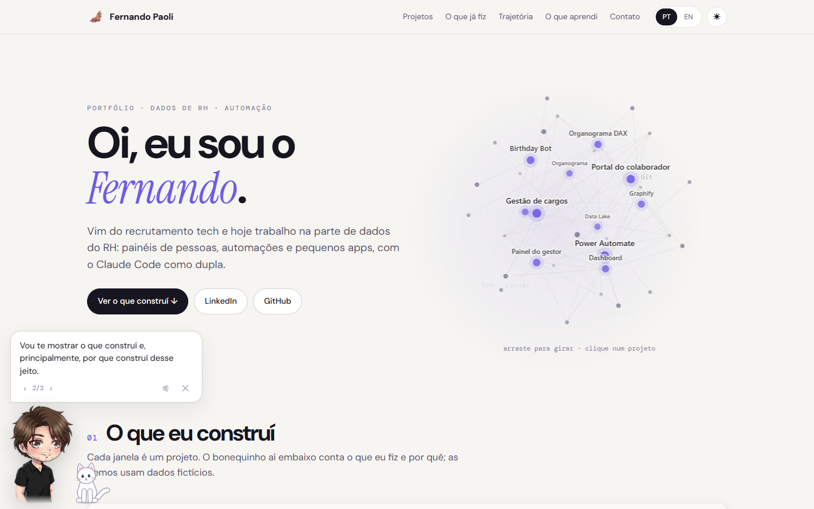
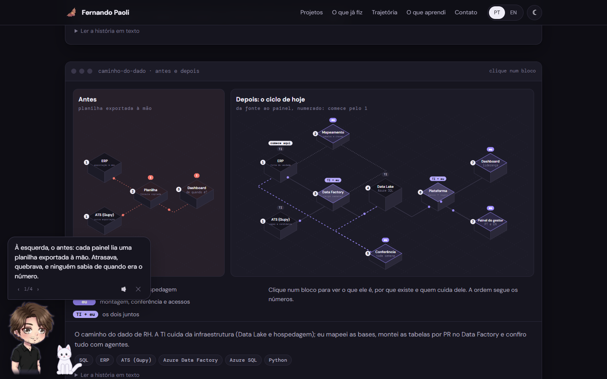

# fernandotrecruiter.github.io

My portfolio and welcome letter: **[fernandotrecruiter.github.io](https://fernandotrecruiter.github.io/)**

A single page read top to bottom. Each project lives in a **window** (minimize, full screen, dock), a little version of me tells **what I did and why** in each one, and a white cat helps with absolutely nothing (drag it and see).



## What is inside

| Piece | File | How |
|---|---|---|
| 3D sphere of projects and tools | `js/constelacao.js` | hand-made 3D on a `<canvas>`: points on a sphere, rotation + perspective every frame, drag to rotate, click a project to jump to its window |
| People dashboard demo | iframe of [people-analytics-dashboard](https://github.com/FernandoTRecruiter/people-analytics-dashboard) | the real demo, running inside the window |
| Data path in 3D, before and after | `js/pipeline.js` | boxes on an isometric floor, numbered in reading order with a "start here" tag, and packets running through the pipes. Clicking a box opens a floating card: what it is, why it exists and who takes care of it (IT, me, or both) |
| Power Automate flowcharts | `js/fluxos.js` | each flow is a list of steps; a token walks the path and takes the other branch on every lap |
| The agent team | `js/agentes.js` | Claude Code subagents in orbit around "me, I decide" |
| What I've done | `js/conteudo.js` > `cases` | the work I delivered, three lines each: problem, solution, outcome (no company data) |
| The narrator | `js/boneco.js` + `js/narrador.js` | SVG character that types each line, blinks, follows the mouse, waves, and reads aloud: **my recorded voice** when the file exists, the browser voice when it doesn't |
| The cat | `js/gato.js` + `css/gato.css` | walks around, sometimes plays with the page; click and drag stretches it |
| Off the clock | `js/conteudo.js` > `sobreMim` | games, side projects, PC building, airsoft: a list, easy to edit |
| All texts, PT and EN | `index.html` (PT) and `js/conteudo.js` (EN + narrator lines) | change a sentence in one place only |

No build, no framework, no tracking. Fonts from Google Fonts; everything else is in this repo.

## Edit, add a project, record my voice

[`CLAUDE.md`](CLAUDE.md) is the map: where each thing lives, the rules (no employer names, censored screenshots only, PT first with EN alongside) and step-by-step recipes. Recording my own voice: [`audio/LEIA-ME.md`](audio/LEIA-ME.md), with the script of every line in [`audio/ROTEIRO.md`](audio/ROTEIRO.md).

## Run locally

Open `index.html`. To see the dashboard window locally, keep the `people-analytics-dashboard` folder next to this one.

Handy URL parameters: `?lang=en`, `?tema=escuro` (dark), `?foto=1` (freezes animations for screenshots).

## Tests

```bash
pip install websocket-client
python tests/teste_portfolio.py
```

A real Edge or Chrome, driven through the DevTools protocol, opens the page and checks 13 things: no JavaScript error in PT/EN and light/dark, every text has its English version, the narrator follows the sections, the windows minimize/maximize/dock, the demo loads, the pipeline blocks explain themselves, the lists come from the data files, the 3D sphere jumps to the right window, nothing overflows on a 390 px phone, and the English page shows no Portuguese.



## License

MIT. Built by Fernando Paoli with Claude Code as my pair.
